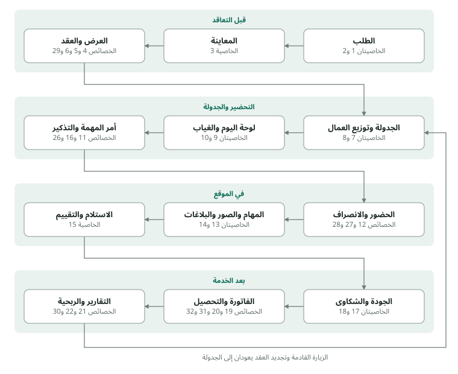

## الخلاصة

نقترح نظاماً واحداً يدير عمل مركز إنماء للخدمات من أول اتصال بالعميل إلى التحصيل والتجديد، للأقسام الثلاثة: المنازل، المؤسسات، العمارات. يبدأ النظام بـ33 خاصية عند الانطلاق، وتنتظر 16 خاصية أخرى مرحلة النمو، لكل منها علامة تدل على أن وقتها حان.

قرأنا دراسة المشروع واستماراتكم الثماني كأفكار تدرسونها لا كقرارات نهائية. في الجداول، «من وثائقكم» تعني أن الفكرة وردت عندكم، و«إضافة منّا» تعني أننا نقترحها ونشرح سببها؛ وحيث أضفنا تفصيلاً صغيراً إلى فكرة من وثائقكم كتبنا بجانبه «(إضافة منّا)». أغلب الإضافات مما تقدّمه برامج إدارة شركات التنظيف المعروفة، وبعضها يفرضه القانون الجزائري.

المطلوب منكم الإجابة عن 26 سؤالاً في قسم «أسئلة للتحقق من الخطة». لا يحتاج أيٌّ منها معرفة تقنية، وحيث تختلف وثائقكم أو تترك أمراً مفتوحاً سألناكم بدل أن نختار عنكم. بإجاباتكم تكتمل الصورة التي نحتاجها لبدء البناء.

## رحلة العمل في النظام

الخصائص 23 و24 و25 و33 (الصلاحيات، الترقيم، ملف العامل، حماية البيانات) تعمل في كل المراحل، لذلك لا تظهر في خطوة بعينها.

## ما يحتاجه المركز عند الانطلاق

عند الانطلاق نقترح 33 خاصية تغطي دورة العمل كاملة: 24 منها وردت في وثائقكم، و9 نضيفها ونشرح سبب كل منها. أرقام العمود الأول تُستعمل للإحالة في بقية الخطة، و«س» تعني سؤالاً من قسم الأسئلة.

### من وثائقكم

::: {.numbered}
| # | الخاصية | ماذا تقدّم لكم | أين وردت |
|--|------|-----------------|----------|
| 1 | ملف العميل ومواقعه | بطاقة واحدة لكل عميل تجمع كل مواقعه، والأشخاص المسؤولين وأدوارهم (من يوقّع الاستلام، من يستلم الفاتورة، الحارس)، وطريقة الدخول والمفاتيح التي تسلّمها المركز، والأماكن الممنوع دخولها والأشياء الممنوع لمسها، وموافقته على التصوير، وملخصاً سريعاً: آخر خدمة، الخدمة القادمة، حالة الدفع، التقييم. لكل قسم استمارة تسجيله. | استمارات التسجيل الثلاث؛ ملف عميل المنازل ومنه «السجل المختصر للإدارة» |
| 2 | متابعة الطلبات حتى التعاقد | يُسجَّل كل طلب مع مصدره (هاتف، واتساب، فيسبوك، زيارة، توصية)، ونوع الخدمة المطلوبة وتكرارها وأول موعد والأيام المفضلة، ونوع العميل وأولويته. ويمر بمراحل موحّدة للأقسام الثلاثة نتفق عليها (س23)، مثل: جديد، معاينة، عرض سعر، متعاقد أو لم يتم التعاقد، ثم نشط أو متوقف أو منتهٍ. ترون في كل لحظة أين توقف كل طلب. | «مصدر العميل» و«الخدمة المطلوبة» و«حالة الملف» في استمارات التسجيل؛ «معلومات داخلية» في استمارة المؤسسات؛ رحلة العميل في الدراسة |
| 3 | المعاينة الميدانية | استمارات المعاينة الثلاث تُملأ على الهاتف أو الحاسوب اللوحي: حالة كل مساحة، الصعوبة، الصور، تقدير عدد العمال والساعات، وتوصية المعاين. | استمارات المعاينة الثلاث؛ «المعاينة الميدانية» في ملف المنازل واستمارة تسجيل المنازل |
| 4 | حساب التكلفة والسعر | يحسب التكلفة الداخلية (أجور، مواد، نقل، معدات، إشراف، احتياط، ونصيب الإدارة والضرائب والتأمين إن اعتمدتموه، س14)، ثم يضيف هامش الربح والخصم، ويعطي السعر للزيارة وللأسبوع وللشهر. لا يظهر هذا الحساب للعميل. | «التكلفة الداخلية» و«السعر التجاري» في استمارات المعاينة؛ «حساب سعر الخدمة» في الدراسة |
| 5 | عرض السعر واعتماده | عرض يُطبع أو يُرسل عبر واتساب، بتاريخ صلاحية وقائمة بما هو مشمول وغير مشمول، ويمكن أن يجمع تنظيفاً أولياً عميقاً ثم عقداً دورياً. يعتمده المسؤول قبل الإرسال (س6)، ثم تُسجَّل نتيجته: قبول، رفض، طلب تخفيض أو تعديل، مؤجل، لا رد. | عرض السعر و«اعتماد السعر» و«نتيجة العرض» في الاستمارات |
| 6 | العقد وتجديده | نوع العقد ومدته (مرة واحدة، أسبوعي، شهري، 3 أو 6 أشهر، سنوي)، عدد الزيارات وأيامها وساعاتها، عدد العمال، من يوفّر المواد، ما يشمله العقد (كنقل النفايات)، وشروط الغياب والاستبدال والدفع. ينبّهكم النظام قبل انتهاء العقد (إضافة منّا). | عقد الخدمة في ملف المنازل؛ «العقود الشهرية» و«تجديد العقد» في الدراسة؛ «التخلص من النفايات» في استمارة العمارات |
| 7 | الجدولة الدورية التلقائية | ينشئ النظام زيارات كل عقد للأسابيع القادمة تلقائياً، مثلاً السبت والاثنين والأربعاء من 08:00 إلى 12:00، ضمن الأيام والساعات التي يسمح بها الموقع، ويوزّع الأعمال التي تأخذ أكثر من يوم على أيامها. | تصنيف العقود حسب التكرار في الدراسة؛ «برنامج العمل المقترح» و«البرنامج الأسبوعي المقترح» في معاينتي المؤسسات والعمارات؛ «هل يتطلب العمل أكثر من يوم؟» في معاينة المنازل |
| 8 | جدول العمال وعبء العمل | أسبوع كل عامل بمواقعه ومنطقته وساعاته مقارنة بطاقته (مثلاً 40–45 ساعة)، مع تنبيه عند تجاوز الحد اليومي (مثلاً 8 ساعات، س11) أو تداخل موعدين. | «محفظة العاملة» و«نقاط عبء العمل» و«التقسيم الجغرافي» في الدراسة |
| 9 | الغياب والاستبدال | عند تسجيل غياب يقترح النظام البدلاء المتاحين في المنطقة نفسها والوقت نفسه، بدءاً بعمال الاحتياط (س2)، ويجهّز رسالة إبلاغ العميل. | «نظام الغياب» في الدراسة |
| 10 | لوحة اليوم بالألوان | مهام اليوم في شاشة واحدة: الوقت، العميل، المنطقة، العامل، والحالة (مؤكدة، بانتظار التأكيد، جارية، منفذة، مؤجلة، مشكلة، ملغاة؛ القائمة النهائية في س23). تتغير الحالة تلقائياً عند وصول العامل وانتهائه (إضافة منّا). | «نظام الألوان» و«جدول العمليات اليومية» و«النظام اليومي داخل المكتب» في الدراسة |
| 11 | أمر المهمة | يتسلّم العامل ما يحتاجه فقط: العنوان، الوقت، المهام، الأماكن الممنوعة، التعليمات وقواعد السلامة، المواد والمعدات المسلّمة له ومعدات الوقاية، المسؤول في الموقع ورقم المشرف، دون أسعار أو بيانات أخرى عن العميل. يُطبع لمن لا يستعمل الهاتف (س7). | أمر مهمة العاملة في ملف المنازل؛ بطاقة توجيه العامل |
| 12 | الحضور والانصراف | يسجّل العامل الوصول وبداية العمل ونهايته والمغادرة بضغطة زر من هاتفه أو من جهاز مشترك في الموقع (إضافة منّا)، أو يسجّلها المشرف أو المكتب بدلاً منه، مع سبب أي تأخير. | «سجل حضور العاملة» في ملف المنازل؛ «وقت الوصول والمغادرة» في بطاقة التوجيه |
| 13 | قائمة المهام والصور | قائمة كل زيارة تُجمع من المهام اليومية والأسبوعية والشهرية المتفق عليها حسب يومها، ومن مهام خاصة بذلك اليوم، مرتبة حسب الموقع (غرف المنزل، مساحات المؤسسة، مداخل العمارة وطوابقها). يؤشر عليها العامل، مع صور قبل وبعد إذا وافق العميل. | قوائم الفحص؛ الخدمات اليومية والأسبوعية والشهرية في معاينتي المؤسسات والعمارات؛ جدول الطوابق و«مهام خاصة لهذا اليوم» و«قائمة التحقق قبل المغادرة» في بطاقة التوجيه؛ «تصوير المكان» في الدراسة |
| 14 | الإبلاغ عن مشكلة من الموقع | يبلّغ العامل المشرف والمكتب فوراً بنقص مواد أو معدات، أو تلف سابق، أو خطر، أو شكوى ساكن، أو طلب خدمة إضافية يتحول إلى فرصة بيع. | «ملاحظات العامل» في بطاقة التوجيه |
| 15 | نهاية الخدمة والاستلام والتقييم | تقرير إنجاز (كامل، جزئي، لم يكتمل وسببه)، ثم استلام العميل (راضٍ، مع ملاحظات، غير راضٍ) بتوقيعه (س20)، ثم تقييمه من 1 إلى 5 وسؤاله عن الخدمة القادمة. | تقرير نهاية الخدمة والاستلام والتقييم والمتابعة القادمة في ملف المنازل؛ «استلام الخدمة» في بطاقة التوجيه |
| 16 | تذكير العميل قبل الموعد | رسالة قبل الموعد بيوم فيها الوقت واسم المشرف وعدد العمال ورقم التواصل، تُرسل بضغطة عبر واتساب. | «إرسال تأكيد للعميل» في الدراسة |
| 17 | تفتيش المشرف ودرجة الجودة | زيارات تفتيش دورية (س25) بقائمة تقييم ودرجة جودة؛ إذا نزلت الدرجة عن الحد تُنشأ تلقائياً مهمة تصحيح بموعد ومسؤول (إضافة منّا)، ويقترح النظام تدريب العامل أو تغييره. | «نظام مراقبة الجودة» في الدراسة؛ «تقييم المشرف» في بطاقة التوجيه |
| 18 | سجل الشكاوى | لكل شكوى رقم ونوع (جودة، تأخير، سلوك، معدات، تلف، غياب)، مرتبطة بالمهمة والعامل، مع عدّاد لوقت الاستجابة المستهدف (مثلاً ساعتان كما في الدراسة، س25) وطريقة التسوية (إعادة الخدمة أو خصم). | «نظام الشكاوى» و«سياسة التعويض» في الدراسة |
| 19 | الفواتير | يُصدر فاتورة بعد كل خدمة، أو أسبوعية، أو شهرية لكل عقد (س15)، ويجهّز فواتير العقود دفعة واحدة مع كشف بالزيارات المنجزة، بالخصم والترقيم التلقائي، للطباعة أو الإرسال. | «الفاتورة والتحصيل» في ملف المنازل؛ «بيانات الفوترة» في استمارة المؤسسات و«البيانات المالية» في استمارة العمارات؛ خطوة «تقرير» قبل الفاتورة في رحلة العميل بالدراسة |
| 20 | التحصيل والديون | تسجيل كل دفعة (نقداً، CCP، تحويل بنكي، دفع إلكتروني) والمبلغ المتبقي، وقائمة بالفواتير المتأخرة لكل عميل مع رسالة تذكير بالدفع (إضافة منّا). | «حالة الدفع» في ملف المنازل؛ «نظام الدفع» في الدراسة |
| 21 | ساعات عمل كل عامل | مجموع الساعات المنجزة والغيابات والتأخيرات لكل عامل في الأسبوع أو الشهر، جاهزة لحساب الأجور. | «تم تسجيل ساعات العمل» في بطاقة التوجيه؛ «ستدفع للعاملات أسبوعيًا أو شهريًا» في الدراسة |
| 22 | التقارير والمؤشرات | تقرير نهاية اليوم (المنجز، المؤجل، الملغى، الشكاوى، الغياب، الاستبدالات، المحصّل)، وتقارير أسبوعية وشهرية: الإيراد لكل عامل، والهامش محسوباً بتكلفة ساعة العمل التي تحددونها، ونسبة استغلال وقت العمال، والعملاء الجدد والمغادرون. المصاريف والربح الشهري تأتي مع الخاصية 39. | التقارير اليومية والأسبوعية والشهرية والمؤشرات في الدراسة |
| 23 | المستخدمون والصلاحيات | لكل موظف حسابه ودوره (المدير، الاستقبال والمبيعات، العمليات، المشرف، المحاسب، العامل)، ولا يرى إلا ما يخصه: العامل يرى أمر مهمته فقط، والتكلفة الداخلية وهامش الربح للمدير. | «تقسيم الملف إلى 4 مستويات» في ملف المنازل؛ «خاص بالإدارة» في استمارات المعاينة |
| 24 | الترقيم الموحد | رقم تلقائي لكل عميل وموقع ومعاينة وعرض وعقد ومهمة وفاتورة وشكوى، يربطها ببعضها فتتبعون أي ملف من أوله إلى آخره (س23). | «نظام العملاء» في الدراسة؛ أرقام الملفات في كل الاستمارات |
:::

### إضافات منّا

::: {.numbered}
| # | الإضافة | ماذا تقدّم لكم | لماذا تهمّ مركزكم |
|--|-----|-------------|--------------|
| 25 | ملف العامل | بطاقة لكل عامل: الهاتف، المنطقة، الصفة (عامل، قائد فريق) والجنس، الأيام المتاحة والإجازات المعروفة مسبقاً، الخدمات والآلات التي يتقنها، نوع العقد وتاريخ البدء، الطاقة الأسبوعية، الوثائق (نسخة بطاقة التعريف، صحيفة السوابق العدلية مثلاً) والتدريب الذي أتمّه. | وثائقكم تفصّل ملف العميل ولا تتضمن أي استمارة للعامل، مع أن الجدولة والاستبدال والأجور تعتمد كلها على معرفة توفّر كل عامل ومنطقته ومهاراته، والإجازة المسجلة مسبقاً لا تُكتشف صباح يوم العمل. ووثائق العامل تطمئن العميل الذي يُدخل عمالكم بيته. |
| 26 | موقع العميل على الخريطة | لكل موقع رابط على الخريطة يفتحه العامل بضغطة. | العناوين كثيراً ما تعتمد على «أقرب معلم»، والعامل البديل الذي يذهب لأول مرة يضيّع وقتاً في البحث عن المكان. |
| 27 | متابعة حضور العامل وسلامته | عند تسجيل الوصول يُحفظ مكان العامل ويُقارن بمكان الموقع؛ وإذا لم يسجّل وصوله بعد دقائق من موعده يُنبَّه المكتب؛ وزر استغاثة يرسل مكانه إلى المشرف فوراً. | في عقود العمارات والمؤسسات يتكرر خلاف «لم يأتِ أحد اليوم»؛ الوقت والمكان معاً يحسمانه. وتنبيه التأخر يسمح بإرسال بديل قبل أن يلاحظ العميل الغياب، وزر الاستغاثة يحمي العاملة التي تعمل وحدها داخل بيت. |
| 28 | العمل دون إنترنت | يحفظ هاتف العامل ما سجّله عند انقطاع الشبكة ويرسله عند عودتها. | الأقبية والمرائب، وهي ضمن خدمات العمارات في وثائقكم، كثيراً ما تكون بلا تغطية؛ دون هذه الميزة تضيع تسجيلات الحضور والصور. |
| 29 | متابعة العروض المعلّقة | تنبيه للموظف عندما يمرّ على عرض سعر عدد من الأيام دون رد، ليتصل بالعميل. | جزء من العروض يضيع لمجرد غياب المتابعة، وبرامج إدارة الخدمات الميدانية المعروفة تجعل هذه المتابعة تلقائية. |
| 30 | ربحية كل عقد | يقارن الساعات المقدّرة في المعاينة بالساعات المنجزة فعلاً، ويحسب الهامش الحقيقي لكل عقد بتكلفة ساعة العمل التي تحددونها. | الدراسة تجعل «اختبار الأسعار» هدف المرحلة الأولى، وهذه المقارنة تكشف العقد المسعّر بأقل من تكلفته، كعمارة قُدّرت بـ12 ساعة أسبوعياً وتأخذ فعلياً 16، قبل أن تتراكم الخسارة. |
| 31 | البيانات القانونية في الفاتورة | تحمل الفاتورة البيانات التي يفرضها مرسوم الفوترة 05-468 (السجل التجاري والرقم الإحصائي للطرفين، طريقة الدفع وأجله، المبلغ بالأرقام والحروف...)، والرسم على القيمة المضافة حسب نظامكم الضريبي (س16)، وحق الطابع عند الدفع نقداً. | الشركة العميلة لا تسترجع الرسم على القيمة المضافة من فاتورة ناقصة البيانات، فترفضها أو تؤخر دفعها. |
| 32 | سند القبض في الموقع | إذا قبض العامل أو المشرف مبلغاً من العميل يُصدر له سنداً، ويطابق المكتب آخر اليوم ما قُبض بما سُلّم. يُفعَّل حسب إجابتكم على س18. | الدراسة تشترط ألا تمسك العاملة المال إلا بنظام رسمي؛ هذا هو ذلك النظام إن احتجتم إليه. |
| 33 | حماية البيانات | سجل يحفظ من اطّلع على البيانات أو غيّرها ومتى (سعر، خصم، وقت حضور، دفعة، بيانات شخصية)؛ الفاتورة لا تُحذف بل تُلغى إلغاءً ظاهراً وتُحفظ طوال المدة التي يفرضها القانون؛ ونسخة احتياطية يومية من كل البيانات. | حين يعمل عدة موظفين على الأسعار والحضور والنقود يمنع السجل الأخطاء والتلاعب، والنسخة الاحتياطية تحفظ ذاكرة المركز من أي عطل. والقانون يطلب ذلك أيضاً: قانون حماية المعطيات الشخصية المعدَّل سنة 2025 يفرض تسجيلاً آلياً لعمليات الاطلاع على البيانات الشخصية وتعديلها، ومرسوم الفوترة يفرض ترقيماً متسلسلاً وإلغاءً ظاهراً. |
:::

## ما يُؤجَّل إلى مرحلة النمو

16 خاصية يمكن أن تنتظر دون أن يتعطل العمل. لكل منها علامة تدل على أن وقتها حان بدل تاريخ محدد، وبعضها يتقدم إلى الانطلاق حسب إجاباتكم.

::: {.numbered}
| # | الخاصية | المصدر | ماذا تقدّم ولماذا | متى يحين وقتها |
|--|-----|-------|-------------|--------|
| 34 | المخزون والمشتريات | وثائقكم: «المخزن» و«المشتريات» في الدراسة، المواد المسلّمة للعامل في بطاقة التوجيه | يتابع الكميات والحد الأدنى وطلبات الشراء، وما يُسلَّم لكل عامل وموقع. | عندما يصبح لكم مخزن بكميات معتبرة أو أكثر من مشرف يوزّع المواد؛ قبل ذلك تكفي قائمة شراء (س26). |
| 35 | المعدات وصيانتها | وثائقكم: حالة المعدات («تحتاج صيانة») في بطاقة التوجيه | يعرف أين توجد كل آلة وحالتها وموعد صيانتها. | عندما تملكون آلات تتنقل بين المواقع، كآلة تنظيف الأرضيات. |
| 36 | عدة مشرفين ومناطق | وثائقكم: مشرفة لكل 10–15 عاملة، ومشرفو المناطق عند 50 عاملة | لكل مشرف لوحة بمنطقته وعماله ومهامه. | عند تجاوز 15 عاملاً تقريباً أو فتح منطقة ثانية. |
| 37 | التوظيف والتدريب | وثائقكم: برنامج التدريب في الدراسة، والموارد البشرية عند 50 عاملة | متابعة المترشحين والمقابلات وأيام التدريب وتواريخ انتهاء الوثائق. | عندما يصبح التوظيف منتظماً كل شهر. |
| 38 | حساب الأجور كاملاً | وثائقكم: «ستدفع للعاملات أسبوعيًا أو شهريًا» و«مساهمات والتزامات» في الدراسة | الأجر والساعات الإضافية والتسبيقات والاقتطاعات وكشف الراتب. عند الانطلاق تُسلَّم الساعات للمحاسب (الخاصية 21). | عندما يصبح حساب الأجور يدوياً مكلفاً أو مصدر أخطاء (س11، س26). |
| 39 | المصاريف والربح الشهري | وثائقكم: «التكاليف» و«الربح التشغيلي» في تقرير نهاية الشهر | تسجيل المصاريف (كراء، نقل، مواد، هاتف) لرؤية الربح الشهري دون انتظار كشف المحاسب. | عندما تريدون معرفة الربح كل شهر دون انتظار المحاسب، أو من البداية حسب إجابتكم على س26. |
| 40 | متابعة زيارات المندوب | وثائقكم: المندوب الذي يزور الشركات والعمارات في الدراسة | قائمة بالمؤسسات والعمارات التي زارها المندوب ومواعيد إعادة الاتصال بها. | عند توظيف مندوب مبيعات. |
| 41 | التحليلات المتقدمة والتدفق النقدي | وثائقكم: «نسبة الاحتفاظ بالعميل» و«آجال الدفع» في الدراسة | الربحية حسب الخدمة والمنطقة والعميل، وتوقّع المداخيل والمصاريف للأشهر القادمة. | بعد بضعة أشهر من التشغيل، حين تتوفر بيانات كافية. |
| 42 | الرسائل الآلية | وثائقكم (التأكيد قبل 24 ساعة)، والإرسال الآلي إضافة منّا | تُرسل التذكيرات ورسالة «العامل في الطريق» والفواتير وطلبات التقييم دون تدخل الموظف، عبر واتساب أو SMS، ويُدعى العميل الراضي إلى تقييم المركز على فيسبوك أو غوغل. | عندما تتجاوز الزيارات اليومية ما يستطيع موظف إرساله بيده، نحو 20 زيارة في اليوم مثلاً. |
| 43 | الدفع بالبطاقة | وثائقكم: «وسائل دفع إلكترونية» في الدراسة | يدفع العميل بالبطاقة الذهبية أو CIB من رابط في الفاتورة، أو بقراءة رمز Baridi Pay من تطبيق بريدي موب، عبر مزوّد دفع معتمد، فيقلّ التعامل بالنقد ولا يُستحق على الدفع حق الطابع. | عندما يطلبه العملاء أو يصبح النقد عبئاً (س19). |
| 44 | صفحة العميل | إضافة منّا | يرى العميل مواعيده وفواتيره وتقارير زياراته، ويطلب خدمة أو يشتكي دون الاتصال بالمكتب. ويجد ممثلو العمارات والشركات فيها كشفاً بالزيارات المنجزة يبرّرون به الدفع أمام السكان أو الإدارة. | عندما يكثر عملاء العقود وتكثر مكالماتهم للمكتب (س22). |
| 45 | الحجز عبر الإنترنت بسعر فوري | إضافة منّا | استمارة حجز تُنشر على فيسبوك وإنستغرام للخدمات البسيطة، تعطي السعر فوراً وتقترح موعداً متاحاً. دراستكم تضع فيسبوك وإنستغرام بين قنوات جلب عملاء المنازل، والاستمارة تحوّل الإعلان إلى طلب دون انتظار رد الموظف. والقانون يشترط أن يكون موقع البيع الإلكتروني مستضافاً في الجزائر بامتداد com.dz. | عندما يصبح الرد على رسائل الحجز عمل موظف كامل. |
| 46 | تنظيم التنقل والمسارات | وثائقكم (النقل وزمن الوصول في استمارات المعاينة)، وترتيب المسار إضافة منّا | ترتيب زيارات اليوم لكل فريق حسب الطريق، ومتابعة سيارات المركز، فيقلّ وقت الطريق وتكلفة النقل. | عندما تملكون سيارات لنقل الفرق أو تغطون مناطق متباعدة (س9). |
| 47 | الفروع | إضافة منّا | فصل البيانات والتقارير حسب الفرع أو الولاية، لأن دراستكم تخطط للوصول إلى 100 عامل وأكثر. | عند فتح نشاط في ولاية أخرى. |
| 48 | الربط مع برنامج المحاسب | إضافة منّا | نقل الفواتير والمدفوعات آلياً إلى برنامج المحاسبة بدل التصدير اليدوي، فيوفّر وقت المحاسب ويقلّل أخطاء النقل. | عندما يصبح التصدير الشهري عبئاً على المحاسب. |
| 49 | رموز QR في العمارات والمؤسسات | إضافة منّا | يقرأ العامل بهاتفه رمز QR مثبتاً في كل مدخل أو طابق فيُسجَّل أنه مرّ به، ويقرأ الساكن أو الموظف رمزاً آخر ليبلّغ عن مشكلة مباشرة. يعطي ممثل العمارة دليلاً على تنظيف كل طابق لا تعطيه الصور وحدها. | عندما يطلب عملاء العمارات أو المؤسسات دليلاً على كل طابق، أو تكثر شكاوى السكان. |
:::

<!-- مكان مقترح لقسم «التكلفة والمدة» يضيفه المطوّر قبل إرسال الخطة. -->

## ما يبقى خارج النظام

هذه البنود الثمانية وردت في وثائقكم، لكنها أعمال أو قرارات تُدار خارج النظام. العمود الأخير يوضح ما يفعله النظام بشأن كل منها.

| البند | أين ورد | لماذا خارج النظام | ما يفعله النظام |
|---------|----|------|----------|
| محتوى برنامج التدريب (7 أيام) وقواعد سلوك العامل داخل المنازل | الدراسة | تدريب تقدّمونه أنتم | يسجّل من أتمّ التدريب (25)، ويعرض الممنوعات في أمر المهمة (11). |
| الزي الموحد وبطاقة التعريف المطبوعة وحقيبة العاملة ومعدات الوقاية | الدراسة؛ بطاقة التوجيه | مشتريات وتجهيز | يذكّر العامل بمعدات الوقاية في أمر المهمة (11)، وتُتابَع كمياتها مع المخزون (34). |
| قواعد السلامة مع المواد الكيميائية، وتقييم الأعمال على الارتفاعات | الدراسة؛ معاينة العمارات | تدريب العمال، وقرار فني يتخذه المسؤول في الموقع | يعرض قواعد السلامة في أمر المهمة (11)، ويسجّل في المعاينة أن العمل على الارتفاعات يحتاج تقييم سلامة، فلا يُدرج في العرض قبل اعتماده (3، 5). |
| التسويق: صفحات التواصل والإعلانات وملف التعريف التجاري للمركز ورسالة «خدمة مُدارة» | الدراسة | عمل تسويقي | يسجّل مصدر كل عميل لتعرفوا أي قناة تجلب العملاء (2). |
| المحاسبة العامة والتصريحات الجبائية والاجتماعية | الدراسة (محاسب خارجي) | عمل المحاسب | يسلّمه الفواتير والمدفوعات وساعات العمال جاهزة (19، 20، 21). |
| صياغة نصوص العقود وسياسة المسؤولية والتعويض | الدراسة | نصوص قانونية تكتبونها أو يراجعها مختص | يطبعها في العقود ويطبّق شروطها، كالاستبدال والخصم (6، 18). |
| نموذج الربحية الافتراضي والتوقعات المالية (10 عاملات × 100,000 دج) | الدراسة | تخطيط مالي | يعطيكم الأرقام الفعلية لمقارنتها بالتوقعات (22، 30). |
| الهيكل الإداري وقرارات التوظيف عند 10 و50 و100 عامل | الدراسة | قرارات تنظيمية | يدعمها بالأدوار والصلاحيات (23). |

وخارج النظام أيضاً، وإن لم تذكره وثائقكم: يفرض القانون 18-07 المعدَّل سنة 2025 على كل مؤسسة تعالج بيانات أشخاص (العملاء والعمال، ومكان العامل عند تسجيل الحضور) أن تصرّح بذلك مسبقاً لدى السلطة الوطنية لحماية المعطيات ذات الطابع الشخصي، وأن تعيّن مسؤولاً عن حمايتها. تسجيل الحضور بالبصمة يحتاج ترخيصاً مسبقاً منها، لذلك لم نقترحه، ونقل البيانات إلى خوادم خارج الجزائر يحتاج ترخيصاً نراعيه في اختيار مكان استضافة النظام. التصريح نفسه من مسؤولية المركز، والنظام لا يجمع إلا البيانات المصرّح بها ويحفظ سجل الاطلاع عليها (33).

## أسئلة للتحقق من الخطة {#questions}

26 سؤالاً لا يحتاج أيٌّ منها معرفة تقنية. كل سؤال موجود لأن جوابه يغيّر ما سنبنيه، والعمود الثالث يوضح كيف. حيث تختلف وثائقكم أو تترك أمراً مفتوحاً سألناكم بدل أن نختار عنكم. يمكنكم الإجابة في العمود الأخير، أو برسالة تذكرون فيها رقم السؤال.

<!-- بعد إنشاء نموذج Google من ../questions-form.gs يمكن إضافة هذه الجملة مع الرابط:
ويمكنكم الإجابة من الهاتف عبر هذا النموذج: [رابط النموذج](ضع-الرابط-هنا)
-->

### البداية والحجم

::: {.numbered .questions}
| # | السؤال | لماذا نسأل | إجابتكم |
|--|----------------|----------|------|
| س1 | بأي الأقسام ستبدؤون: المنازل، المؤسسات، العمارات، أم الثلاثة معاً؟ | نبني أولاً استمارات القسم الذي ستبدؤون به وقوائم مهامه، ويدخل القسم المؤجَّل لاحقاً. |  |
| س2 | كم عاملاً وكم موظف مكتب ستبدؤون بهم، وكم تتوقعون بعد سنة؟ الدراسة تذكر 5–10 عاملات ثم 20 ثم 100 فأكثر، وتترك المرحلة الثالثة فارغة. وكيف تنظّمون الاحتياط: عمال احتياط ثابتون (مثلاً 2 لكل 10 كما في الدراسة)، أم بديل لكل منطقة؟ | الحجم يحدد متى تنتقل خصائص مرحلة النمو إلى الانطلاق، مثل تعدد المشرفين (36) والمخزون (34)؛ وطريقة الاحتياط تحدد من يقترحه النظام بديلاً (9). |  |
| س3 | في أي مدينة أو ولايات ستعملون عند الانطلاق؟ وهل ستقسّمونها إلى مناطق من البداية كما تقترح الدراسة؟ إن نعم، ما هي المناطق؟ | المناطق أساس توزيع العمال واقتراح البدلاء (8، 9). |  |
| س4 | هل لديكم الآن عملاء أو عمال مسجلون في مكان ما (دفتر، Excel، هاتف)؟ كم عددهم تقريباً؟ | إن وُجدوا نُدخل بياناتهم في النظام قبل التشغيل. |  |
:::

### من يفعل ماذا

::: {.numbered .questions}
| # | السؤال | لماذا نسأل | إجابتكم |
|--|----------------|----------|------|
| س5 | عند الانطلاق، من سيتولى كل مهمة من المهام التالية: تسجيل الطلبات، المعاينة، إعداد عروض الأسعار، اعتمادها، جدولة العمال، الإشراف الميداني، قبض المال، إصدار الفواتير؟ (يمكن لشخص واحد أن يتولى عدة مهام) | لكل دور حساب وصلاحيات (23)؛ الدراسة تقترح خمسة أدوار بينما تبدؤون بفريق صغير. |  |
| س6 | هل يجب أن يمر كل عرض سعر عليكم قبل إرساله، أم فقط العروض التي فيها خصم أو تتجاوز مبلغاً معيناً؟ وكم هذا المبلغ؟ | استمارات المعاينة تفصل بين من يعدّ السعر ومن يعتمده؛ الجواب يحدد متى يُوقف النظام العرض في انتظار موافقتكم (5). |  |
:::

### العمال في الميدان

::: {.numbered .questions}
| # | السؤال | لماذا نسأل | إجابتكم |
|--|----------------|----------|------|
| س7 | هل لدى كل العمال هاتف ذكي فيه إنترنت أثناء العمل؟ وهل يقرؤون العربية أو الفرنسية بسهولة؟ إن لم يكن ذلك للجميع، من يسجّل حضورهم ومهامهم بدلاً منهم: المشرف أم المكتب؟ | يحدد هل نبني تطبيقاً للعامل، أم نطبع أوامر المهام ويسجّل غيره بدلاً منه (11 إلى 14، 27، 28). |  |
| س8 | هل يعمل العامل منفرداً في الغالب، أم ضمن فريق له قائد كما في بطاقة توجيه العمارات؟ وفي الفريق، هل يسجّل القائد حضور الجميع؟ | يحدد هل يُصدَر أمر المهمة ويُسجَّل الحضور لكل عامل أم لكل فريق (11، 12). |  |
| س9 | كيف سيتنقل العمال إلى المواقع: سيارة المركز، النقل العمومي، أم وسيلتهم الخاصة؟ ومن يتحمل تكلفة التنقل؟ | يحدد هل يُحسب وقت الطريق بين موقعين في الجدول وتكلفة النقل في السعر (4، 8)، ومتى نحتاج تنظيم المسارات (46). |  |
| س10 | ما أيام عمل المركز وأوقاته؟ الدراسة تجعل العمل من السبت إلى الخميس والجمعة عطلة، بينما تشمل استمارتا المؤسسات والعمارات يوم الجمعة. وهل تعملون بفترات ثابتة (تذكر الدراسة 09:00–12:00 و13:30–16:00، وفي موضع آخر 08:00–12:00 وخدمات مسائية من 14:00) أم في أي ساعة يطلبها العميل؟ وهل ستقدّمون خدمات ليلية بين التاسعة مساءً والخامسة صباحاً؟ | هذه قواعد التقويم التي تُبنى عليها الجدولة الدورية وحساب طاقة العمال (7، 8)، وقانون العمل يمنع العمل الليلي للعاملات إلا بترخيص من مفتشية العمل، فينبّه النظام عند الجدولة. |  |
| س11 | كيف يُدفع أجر العامل: راتب شهري، أجر يومي، بالساعة، أم بالمهمة؟ وكل أسبوع أم كل شهر؟ وكم ساعة يعمل في الأسبوع بدوام كامل حسب عقده (الدراسة تذكر 40–45 ساعة مرة و40–48 مرة أخرى)، وكم ساعة في اليوم كحد أقصى (تقترح الدراسة 8 مثلاً)؟ | يحدد ما يسجّله النظام لكل عامل (ساعات أم مهام) والحدود التي ينبّه عندها (8، 21، 38). للعلم: يحدد القانون 40 ساعة أسبوعياً، والساعات الإضافية استثنائية في حدود 20% وبأجر أعلى. |  |
| س12 | هل هناك عملاء أو خدمات تشترط عمالاً بعينهم؟ مثلاً: العامل نفسه في كل زيارة (كما في استمارتي المؤسسات والعمارات)، أو عاملات فقط داخل المنازل، أو عامل يتقن آلة معينة. | يحدد القواعد التي يتبعها النظام حين يقترح عاملاً أو بديلاً، فلا يقترح من لا يقبله العميل (8، 9، 25). |  |
:::

### الأسعار والعقود

::: {.numbered .questions}
| # | السؤال | لماذا نسأل | إجابتكم |
|--|----------------|----------|------|
| س13 | هل ستبيعون باقات جاهزة بأسعار ثابتة، أم تسعّرون كل عميل بعد المعاينة؟ الدراسة تقترح باقات تختلف في عدد الزيارات والخدمات (للعمارات: BASIC مرتين وSTANDARD ثلاث مرات وPREMIUM ست مرات أسبوعياً؛ وللمكاتب باقات حسب عدد الزيارات؛ وللمنازل باقات حسب نوع الخدمة)، بينما تذكر استمارة معاينة العمارات أربعة مستويات دون تعريفها (أساسي، قياسي، متقدم، شامل). | الباقات تعني قائمة أسعار جاهزة في النظام؛ التسعير بعد المعاينة يعني حساباً لكل عميل (4، 5). |  |
| س14 | كيف تحسبون السعر في كل قسم؟ استمارات المعاينة تحسبه من التكاليف المباشرة زائد هامش الربح، بينما تضيف الدراسة نصيب الإدارة والضرائب والتأمين؛ واستمارة تسجيل العمارات تقترح أيضاً السعر لكل زيارة أو حسب عدد المداخل أو الطوابق أو المساحة. وما الخدمات التي تسعّرونها بالهاتف دون معاينة، وعلى أي أساس (بالساعة، بالمتر المربع، بالغرفة، سعر ثابت)؟ | يحدد طريقة الحساب لكل قسم وبنود التكلفة فيه (4، 30)، وهل نضيف حاسبة سريعة لأسعار الهاتف. |  |
| س15 | كيف تفوترون: بعد كل خدمة، أسبوعياً، أم شهرياً (الاستمارات تذكر الثلاثة)؟ وفي العقود الشهرية، هل تُصدرون الفاتورة بمبلغ ثابت في بداية الشهر، كما تنصح الدراسة، أم في نهايته حسب الزيارات المنجزة فعلاً؟ وإذا فاتت زيارة دون بديل، هل تُخصم من الفاتورة أم تُعوَّض بزيارة أخرى؟ وإذا ألغى العميل في آخر لحظة أو لم يفتح الباب، هل تُحتسب الزيارة عليه؟ | يحدد كيف يحسب النظام الفواتير وما يُكتب في العقد عن الغياب والإلغاء (6، 19). |  |
:::

### الفواتير والدفع

::: {.numbered .questions}
| # | السؤال | لماذا نسأل | إجابتكم |
|--|----------------|----------|------|
| س16 | هل تفوترون بالرسم على القيمة المضافة (TVA)، أم أنتم في نظام الضريبة الجزافية الوحيدة (IFU)؟ محاسبكم يعرف الجواب. واسألوه أيضاً: هل يشترط القانون أن تصدر الفواتير أو تُسجَّل المبيعات من برنامج معتمد؟ | النظام الضريبي يغيّر شكل الفاتورة وطريقة حساب مبالغها (31). وإن كان البرنامج المعتمد شرطاً، نبني النظام ليستوفيه أو نربطه ببرنامج فوترة معتمد. |  |
| س17 | هل تتوقعون عملاء من الإدارات العمومية أو الشركات الكبيرة؟ استمارة تسجيل المؤسسات تتضمن القطاع العام. وهل يطلب هؤلاء وثائق خاصة، كشهادة إنجاز الخدمة كل شهر أو استلام موقّع ومختوم؟ | إن نعم نضيف هذه الوثائق ونتابع آجال الدفع الطويلة في التحصيل (19، 20). |  |
| س18 | عندما يدفع عميل منزلي نقداً في نهاية الخدمة، من يقبض المال: العامل، المشرف، أم يدفع للمكتب فقط؟ وهل تطلبون عربوناً قبل بعض الخدمات، كالتنظيف بعد البناء؟ | الدراسة تقول إن العاملة لا تمسك المال إلا بنظام رسمي؛ الجواب يحدد هل نفعّل سند القبض والمطابقة اليومية (32)، وهل نسجّل العربون قبل الخدمة (20). |  |
| س19 | هل تريدون أن يدفع العملاء بالبطاقة الذهبية أو CIB من رابط في الفاتورة؟ هذا يتطلب اتفاقاً مع بنك أو مزوّد دفع. أم يكفي تسجيل ما يُدفع نقداً أو عبر CCP أو التحويل أو الصك؟ | الدفع بالبطاقة ربط إضافي نؤجله إلى مرحلة النمو ما لم تحتاجوه من البداية (43). |  |
:::

### التواصل مع العملاء

::: {.numbered .questions}
| # | السؤال | لماذا نسأل | إجابتكم |
|--|----------------|----------|------|
| س20 | هل يكفي أن يوقّع العميل على شاشة الهاتف (على استمارة التسجيل، وقبول عرض السعر، واستلام الخدمة)، أم يحتاج بعض العملاء، خاصة المؤسسات، إلى وثائق ورقية موقّعة ومختومة؟ | يحدد هل تكون التوقيعات رقمية فقط أم نطبع الوثائق أيضاً (2، 5، 15). |  |
| س21 | بأي لغة يعمل النظام وتصدر الوثائق: العربية، الفرنسية، أم الاثنتان؟ مثلاً فواتير بالفرنسية للشركات وتطبيق بالعربية للعمال. | اللغتان معاً تعني أن تُكتب كل شاشة ووثيقة بالاثنتين. |  |
| س22 | هل تريدون أن يتعامل العملاء مع النظام مباشرة منذ البداية (رابط لتأكيد الموعد أو للتقييم أو لرؤية الفواتير)، أم يمر كل شيء عبر المكتب بالهاتف وواتساب؟ | صفحة العميل مؤجلة إلى مرحلة النمو (44)؛ إن احتجتموها من البداية ننقلها إلى الانطلاق. |  |
:::

### توحيد ما تختلف فيه الوثائق

::: {.numbered .questions}
| # | السؤال | لماذا نسأل | إجابتكم |
|--|----------------|----------|------|
| س23 | وثائقكم تعطي الشيء نفسه رموزاً مختلفة (العميل CL أو CUS أو CL-H، المعاينة VIS أو INS، العرض QT أو Q، العقد CT أو CTR أو CON، العامل W أو EMP). نقترح ترقيماً واحداً للأقسام الثلاثة بحرف يدل على نوع الوثيقة (CL للعميل، INS للمعاينة، Q للعرض، CTR للعقد، JOB للمهمة): هل توافقون، أم تفضلون حرفاً يميّز القسم (مثل H للمنازل)؟ وقوائم الحالة تختلف كذلك: هل نعتمد مراحل واحدة للملف (جديد، معاينة، عرض سعر، متعاقد أو لم يتم التعاقد، ثم نشط أو متوقف أو منتهٍ)، وحالات واحدة للمهمة (مؤكدة، بانتظار التأكيد، جارية، منفذة، مؤجلة، مشكلة، ملغاة)؟ | النظام يرقّم الوثائق ويتابع المراحل والحالات تلقائياً، ويحتاج صيغة واحدة لكل منها (2، 10، 24). |  |
| س24 | (أ) الحروف A إلى E تعني في وثائقكم أشياء مختلفة: تكرار العقد في الدراسة، مستوى الخدمة في معاينة المنازل، ودرجة الصعوبة في معاينة المؤسسات؛ و«التصنيف الأولي للعميل» A–D في استمارة المؤسسات بلا تعريف. ماذا يعني تصنيف العميل؟ وهل نحتفظ بالحروف أم نستعمل أسماء صريحة؟ (ب) لدرجة الصعوبة ثلاثة سلالم: أربع درجات في استمارتي المنازل، وثلاث لكل مساحة في معاينة المنازل، وخمس في معاينة المؤسسات. أيها تعتمدون؟ (ج) حالة النظافة تُقاس بسلالم من ثلاث إلى خمس درجات بتسميات مختلفة. أيها نعتمد؟ | إن كان للتصنيف أثر (أولوية، سعر، مشرف) نبنيه في النظام وإلا نحذفه، والسلّم الموحد يسمح بمقارنة المعاينات (2، 3، 7). |  |
| س25 | كيف تقيسون الجودة: درجة من 100 مع إجراء تحت 80 كما في الدراسة، أم تقدير من خمس درجات من «ممتاز» إلى «يحتاج إلى إعادة» كما في بطاقة التوجيه؟ وكم مرة يزور المشرف كل عقد للتفتيش (تذكر الدراسة زيارة أسبوعية، ومراقبة شهرية في مثال عقد العمارة)؟ وما الوقت المستهدف للرد على الشكوى (تقترح الدراسة ساعتين مثلاً)؟ وتقييم العميل: أربعة معايير كما في الدراسة، أم خمسة مع سؤال «هل توصي بنا؟» كما في ملف المنازل؟ | يحدد شكل استمارة التفتيش والتقييم، وعدد زيارات التفتيش، والحدود التي تطلق إجراءً أو تنبيهاً (15، 17، 18). |  |
:::

### نطاق الانطلاق

::: {.numbered .questions}
| # | السؤال | لماذا نسأل | إجابتكم |
|--|----------------|----------|------|
| س26 | هل في قائمة مرحلة النمو ما تحتاجونه من اليوم الأول؟ مثلاً المخزون الذي تفصّله الدراسة (34)، أو حساب الأجور داخل النظام (38)، أو تسجيل المصاريف لرؤية الربح الشهري (39). وهل في قائمة الانطلاق ما لا تحتاجونه؟ | هذا يحدد مباشرة ما نبنيه أولاً. |  |
:::

## ملحق: وثائقكم ومكانها في الخطة {#appendix}

راجعنا كل نموذج وإجراء في وثائقكم التسع، ولكلٍّ مكانه هنا: رقم خاصية، أو سؤال (س)، أو «خارج النظام». «ملف المنازل» هو ملف العميل المتكامل لقسم المنازل، و«بطاقة التوجيه» هي بطاقة توجيه العامل في قسم العمارات.

| الوثيقة | الجزء | مكانه في الخطة |
|-----|-------------------|---------|
| الدراسة | نموذج العمل: العميل يتعامل مع المركز لا مع العاملة | 1، 11، 23 |
| الدراسة | الأقسام الثلاثة وخدمات كل قسم | 1، 3؛ س1 |
| الدراسة | رحلة العميل من الاتصال إلى التحصيل، ورحلة العمارة، والتصور النهائي | الخطوات المبيّنة في رسم «رحلة العمل في النظام» |
| الدراسة | رحلة العاملة من التوظيف إلى تنفيذ المهمة: التدريب والسلوك واللباس وأمر المهمة مفصّلة، والتوظيف نفسه غير مفصّل | 11، 25، 37؛ خارج النظام (محتوى التدريب) |
| الدراسة | التسعير بالهاتف أو بعد المعاينة، وحساب سعر الخدمة (ومنه الإدارة والضرائب والتأمين) | 3، 4؛ س14 |
| الدراسة | محفظة العاملة، نموذج «6 مهام»، نقاط عبء العمل، حدود 8 ساعات يومياً و40–48 أسبوعياً | 7، 8؛ س10، س11 |
| الدراسة | مثال عملي: 10 عاملات لكل منهن 6 عملاء، أي 60 عقداً ونحو 100 مهمة أسبوعياً | 8؛ س2 |
| الدراسة | تصنيف العقود A–E حسب التكرار | 7؛ س24 |
| الدراسة | الهيكل الإداري عند 10 و50 و100 عامل | 23، 36؛ خارج النظام (قرارات التوظيف) |
| الدراسة | التقسيم الجغرافي إلى مناطق | 8، 9؛ س3 |
| الدراسة | نظام الألوان، جدول العمليات اليومية، النظام اليومي داخل المكتب، التقارير اليومية والأسبوعية والشهرية | 10، 22؛ س23 |
| الدراسة | نظام الغياب والعاملات الاحتياط | 9؛ س2 |
| الدراسة | العقود الشهرية والدفع المسبق وآجال الدفع | 6، 19، 20، 41؛ س15 |
| الدراسة | طرق الدفع وقاعدة «العاملة لا تمسك المال» | 20، 32، 43؛ س18، س19 |
| الدراسة | المؤشرات: الإيراد والهامش لكل عاملة، نسبة الاستغلال، الاحتفاظ بالعميل | 22، 30، 41 |
| الدراسة | نموذج الربحية الشهري | 39؛ خارج النظام (التوقعات) |
| الدراسة | مراقبة الجودة، الشكاوى، سياسة التعويض | 17، 18؛ س25؛ خارج النظام (صياغة السياسة) |
| الدراسة | الحماية من المسؤولية: المشمول وغير المشمول، الأشياء الثمينة، الأضرار السابقة | 1، 5، 14؛ خارج النظام (صياغة السياسة) |
| الدراسة | التدريب وقواعد السلوك واللباس وحقيبة العاملة وسلامة المواد | 11، 25؛ خارج النظام |
| الدراسة | المخزن والمشتريات | 34؛ س26 |
| الدراسة | نظام العملاء والأرقام (CUS، SITE، JOB، INV، CON) | 24؛ س23 |
| الدراسة | التسويق، ملف التعريف التجاري للمركز، المندوب الذي يزور الشركات والعمارات | 2، 40، 45؛ خارج النظام |
| الدراسة | الباقات (BASIC، STANDARD، PREMIUM وغيرها) | س13 |
| الدراسة | مراحل التوسع والخطة المقترحة عند البداية (من 5–10 عاملات إلى 100 فأكثر) | تقسيم الانطلاق والنمو؛ س2 |
| الدراسة | عناوين في الفهرس بلا قسم خاص بها: «الأخطاء التي يجب تجنبها»، و«النماذج والوثائق» (الاستمارات جاءت في وثائق مستقلة)، و«الحسابات والأجور والربحية» (الأجور غير مفصّلة) | لا محتوى يُبنى عليه؛ الاستمارات مغطاة في الأسطر التالية، والأجور في 21 و38 وس11 |
| ملف المنازل | البنود 1–11: التسجيل، السكن وتفاصيله، النوافذ، الحالة، الخدمة المطلوبة وتفاصيلها، نطاق العمل، المواد، التعليمات، الدخول | 1، 2، 3 |
| ملف المنازل | البندان 12–13: المعاينة والصور | 3، 13 |
| ملف المنازل | البنود 14–16: حساب الخدمة، عرض السعر، العقد | 4، 5، 6 |
| ملف المنازل | البنود 17–19: أمر المهمة، قائمة الفحص، سجل الحضور | 11، 12، 13 |
| ملف المنازل | البنود 20–22: تقرير نهاية الخدمة، الاستلام، التقييم | 15؛ س20، س25 |
| ملف المنازل | البند 23: الفاتورة والتحصيل | 19، 20 |
| ملف المنازل | البندان 24–25: المتابعة القادمة والسجل المختصر للإدارة | 1، 7، 15 |
| ملف المنازل | تقسيم الملف إلى 4 مستويات حسب من يطّلع عليه | 23 |
| تسجيل المنازل | البنود 1–10 والبند 14 (تأكيد العميل بتوقيعه) | 1، 2، 3؛ س20 |
| تسجيل المنازل | الأيام المفضلة في البند 6 (من السبت إلى الخميس) | 2، 7؛ س10 |
| تسجيل المنازل | البنود 11–13 وقسم «للاستخدام الإداري» وحالة العميل النهائية | 2، 3، 24؛ س23 |
| معاينة المنازل | أولاً إلى عاشراً: البيانات، المواصفات، الحالة، تقييم كل مساحة، الأعمال، الخدمات الإضافية، حجم العمل وعدد الأيام، المواد، النقل | 3، 4، 7 |
| معاينة المنازل | ثامناً: تصنيف مستوى الخدمة A–E | س24 |
| معاينة المنازل | الحادي عشر إلى الثالث عشر: التكلفة الداخلية، سعر البيع، الخدمات المستثناة | 4، 5 |
| معاينة المنازل | الرابع عشر والخامس عشر: الملاحظات والصور | 3، 13 |
| معاينة المنازل | السادس عشر إلى التاسع عشر: التوصية، اعتماد السعر، نتيجة العميل، اعتماد العميل | 2، 5؛ س6، س20 |
| معاينة المنازل | الحالة الداخلية للمعاينة والعرض والمهمة | 2، 10؛ س23 |
| تسجيل المؤسسات | البنود 1–8 و11–14 و16: الملف، المؤسسة، الاتصال، الموقع، المساحات، الحالة، الخدمات، المواد، التعليمات، الدخول والمفاتيح، موعد المعاينة، ملاحظات العميل | 1، 2، 3 |
| تسجيل المؤسسات | البند 9: دورية الخدمة والأيام المفضلة | 2، 6، 7؛ س10 |
| تسجيل المؤسسات | البند 10: متطلبات المؤسسة بخصوص العمال | 1، 8؛ س12 |
| تسجيل المؤسسات | البند 15: بيانات الفوترة | 19، 31؛ س15، س16، س17 |
| تسجيل المؤسسات | البند 17: الأولوية، نوع العميل، التصنيف A–D | 2؛ س24 |
| تسجيل المؤسسات | البنود 18–20: أرقام الملفات، التأكيد بالتوقيع والختم، الاعتماد والحالة النهائية | 2، 24؛ س20، س23 |
| معاينة المؤسسات | «أولاً» والبنود 1–12: بيانات المعاينة، النشاط، الحالة، تقييم المساحات والأرضيات والزجاج ودورات المياه والمكاتب والمطبخ، الخدمات اليومية والأسبوعية والشهرية، النطاق | 3، 13 |
| معاينة المؤسسات | البنود 13–15: عدد العمال، الساعات، البرنامج المقترح | 3، 7، 8 |
| معاينة المؤسسات | البند 16: وقت الوصول والتنقل | 4؛ س9 |
| معاينة المؤسسات | البند 17: المواد والمعدات | 4، 34 |
| معاينة المؤسسات | البند 18: درجة الصعوبة A–E | س24 |
| معاينة المؤسسات | البنود 19–21: التكلفة والسعر وشروطه | 4، 5 |
| معاينة المؤسسات | البندان 22–23: شروط المؤسسة (الأيام والساعات المسموحة) والصور | 1، 7، 8، 13 |
| معاينة المؤسسات | البنود 24–26: التوصية، اعتماد الإدارة، نتيجة العرض | 2، 5؛ س6 |
| تسجيل العمارات | البنود 1–9: الملف، العمارة، الجهة المتعاقدة، السكان، المواصفات، المساحات المشتركة، الحالة، المشاكل، الخدمات الإضافية | 1، 2 |
| تسجيل العمارات | البندان 10–11: البرنامج المطلوب وعدد العمال | 2، 6، 7؛ س10، س12 |
| تسجيل العمارات | البنود 12–16: المواد، الدخول، مكان تخزين المعدات، النفايات، شخص الاستلام | 1، 5، 6 |
| تسجيل العمارات | البند 17: البيانات المالية (طريقة الاحتساب، الدفع، الفوترة، يوم الدفع) | 19، 20؛ س14، س15 |
| تسجيل العمارات | البنود 18–23: المعاينة، الأرقام، الملاحظات، التأكيد، الاعتماد، الحالة | 2، 3، 24؛ س20، س23 |
| معاينة العمارات | البنود 1–12: البيانات الهندسية، جدول المداخل، تقييم المداخل والسلالم والممرات والمصاعد والأقبية والمساحات الخارجية، النظافة العامة، الخدمات اليومية والأسبوعية والشهرية | 3، 13 |
| معاينة العمارات | البند 10: الأعمال على الارتفاعات | 3؛ خارج النظام (تقييم السلامة) |
| معاينة العمارات | البند 13: مستوى الخدمة (أساسي، قياسي، متقدم، شامل) | س13 |
| معاينة العمارات | البنود 14–16: العمال، الساعات، البرنامج الأسبوعي ويوم الراحة وبديله | 3، 7، 8، 9، 13 |
| معاينة العمارات | البندان 17–18: احتياج المواد والمعدات | 4، 34، 35 |
| معاينة العمارات | البنود 19–22: النقل، التكلفة، السعر الشهري، الخدمات غير المشمولة | 4، 5؛ س9 |
| معاينة العمارات | البنود 23–25: مسؤولية ممثل العمارة، ملاحظات السكان، الصور | 1، 13 |
| معاينة العمارات | البنود 26–28: التوصية، الاعتماد، نتيجة العرض | 2، 5؛ س6 |
| بطاقة التوجيه | البنود 1–6: المهمة، العامل، المكان، المسؤول في الموقع، النطاق، جدول الطوابق والمداخل | 11، 13، 26 |
| بطاقة التوجيه | صفة العامل في البند 2 (عامل، عامل رئيسي، قائد فريق) | 25؛ س8 |
| بطاقة التوجيه | البنود 7–10: المهام، مهام اليوم الخاصة، الممنوعات، التعليمات | 11، 13 |
| بطاقة التوجيه | البندان 11–12: المواد المسلّمة ومعدات الوقاية | 11، 34، 35؛ خارج النظام (التجهيز) |
| بطاقة التوجيه | البند 13: الوصول والمغادرة | 12، 27 |
| بطاقة التوجيه | البنود 14–16: التحقق قبل المغادرة، ملاحظات العامل، حالة الإنجاز | 13، 14، 15 |
| بطاقة التوجيه | البند 17: تقييم المشرف | 17؛ س25 |
| بطاقة التوجيه | البند 18: استلام الخدمة | 15؛ س20 |
| بطاقة التوجيه | البند 19: تقرير الإدارة | يملأ النظام أغلبه تلقائياً من 10 و12 و14 و18 و21، ويبقى «الإجراء المتخذ» قراراً للمسؤول |
| بطاقة التوجيه | القسيمة المقتطعة في آخر البطاقة | 11 (أمر المهمة المطبوع) |
